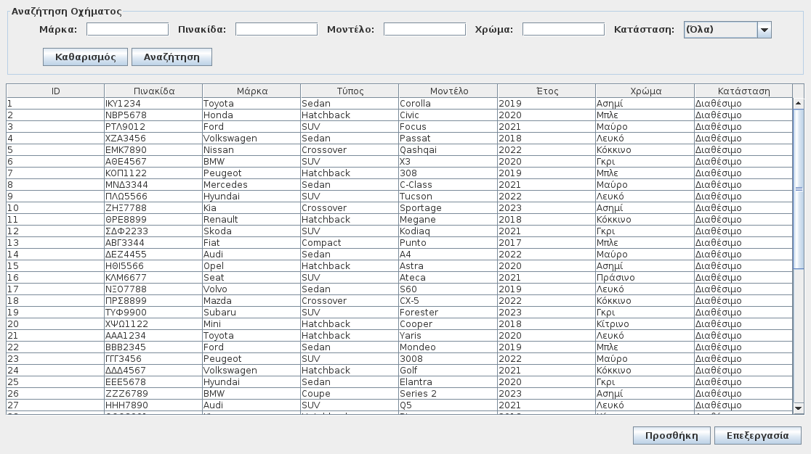
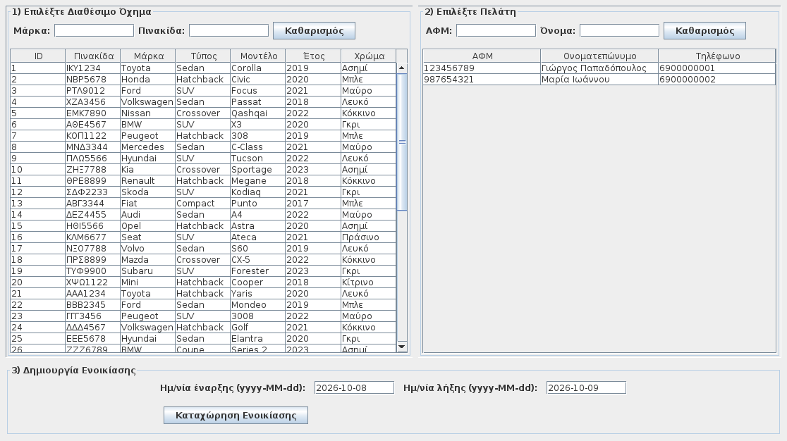

# Car Rental Management

A Java desktop application for managing a car rental business. Employees can manage vehicles and customers, create rentals, record returns, and review rental history through a Greek-language Swing interface.

Developed as a university object-oriented programming project. The application separates the user interface, business rules, domain models, and CSV persistence, and uses only the Java standard library at runtime.

## Features

- Employee login and logout, plus account creation and deletion.
- Vehicle creation, editing, and search by brand, plate, model, color, and availability.
- Customer creation, editing, and search by tax ID (ΑΦΜ), name, and phone number.
- Rental creation with customer selection, date validation, and vehicle availability checks.
- Vehicle returns that complete the rental and restore availability.
- Rental history by customer or vehicle, including active and completed rentals.
- Local CSV storage that preserves changes between application sessions.

## Interface previews

These previews were rendered directly from the application's Swing panels with the bundled demo data. Window decorations and the dashboard's menu and tabs are omitted; appearance may vary by operating system.

### Vehicle management



### New rental



## Technology

| Area | Technology |
| --- | --- |
| Language | Java 8-compatible source |
| Desktop interface | Java Swing |
| Build | Apache Maven |
| Persistence | UTF-8 CSV files |
| Dates | `java.time.LocalDate` |
| Runtime dependencies | Java standard library only |

## Getting started

### Requirements

- JDK 8 or later.
- Apache Maven available as `mvn`.
- A desktop environment to display the Swing interface.

### Build and run

Download or clone the repository, then open a terminal in the project root (the folder containing `pom.xml`):

```bash
mvn clean package
java -jar target/car-rental-management-1.0-SNAPSHOT.jar
```

Alternatively, import `pom.xml` as a Maven project in an IDE and run the `gui.App` class.

### Demo login

| Username | Password |
| --- | --- |
| `jsmith` | `password1` |
| `mjones` | `password2` |

The initial dataset contains 5 employee accounts, 50 vehicles, 2 customers, and no rentals. Additional demo accounts are listed in `src/main/resources/seed/users.csv`.

### Try a rental

1. Log in with a demo account.
2. Open **Ενοικίαση** and select an available vehicle and a customer.
3. Enter start and end dates in `yyyy-MM-dd` format, then select **Καταχώρηση Ενοικίασης**.
4. Open **Επιστροφή**, find the active rental, and record the return.
5. Open **Ιστορικό** to review the rental by customer tax ID or vehicle plate.

## Project structure

| Path | Responsibility |
| --- | --- |
| `src/main/java/api/model/` | Domain classes: `Person`, `Employee`, `Customer`, `Car`, `Rental`, and `CarStatus` |
| `src/main/java/api/service/` | Authentication, validation, and vehicle/customer/employee/rental operations |
| `src/main/java/api/repo/` | Loading and saving CSV records |
| `src/main/java/api/exception/` | Authentication, validation, and not-found exceptions |
| `src/main/java/api/util/` | CSV handling, dates, validation, file paths, and seed initialization |
| `src/main/java/api/AppContext.java` | Creates repositories and services and supplies them to the interface |
| `src/main/java/gui/` | Application entry point, login, and dashboard |
| `src/main/java/gui/panel/` | Vehicles, customers, rentals, returns, history, and users |
| `src/main/java/gui/dialog/` | Vehicle, customer, and employee entry dialogs |
| `src/main/resources/seed/` | Bundled initial users and vehicles |
| `docs/images/` | Rendered interface previews |

## Local data

At startup, the application creates missing files inside `data/`, relative to the current working directory:

| File | Contents |
| --- | --- |
| `data/users.csv` | Employee accounts |
| `data/vehicles.csv` | Vehicles and their current availability |
| `data/customers.csv` | Customer records |
| `data/rentals.csv` | Active and completed rentals |

Existing files are kept, so edits remain available after restarting. The generated `data/` directory is excluded from Git; the initial resources remain versioned under `src/main/resources/seed/`.

## Scope

This is a local academic prototype. Passwords are stored as plaintext CSV values, and data is managed through local files rather than a database. The bundled accounts are demo credentials.

## Contributors

- Αριστοτέλης Κασσελούρης
- Αλεξάνδρα Αντώνογλου

for the "Object-oriented Programming" course.
